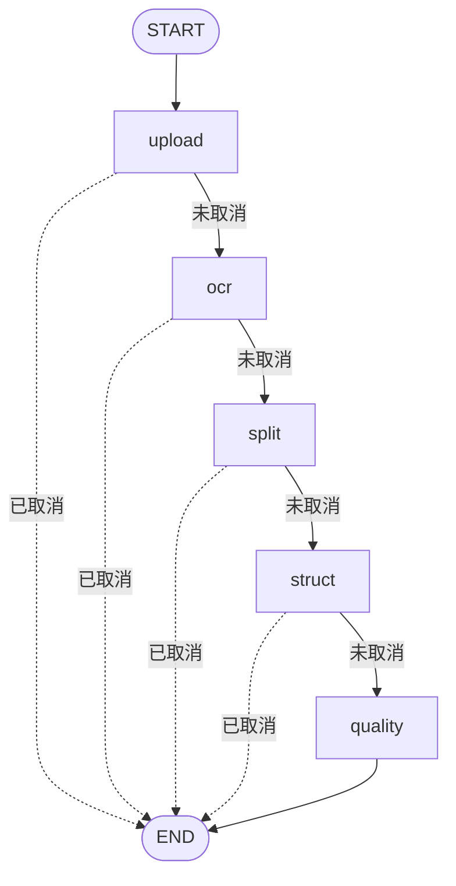

# LangGraph 节点编排

> 改造日期：2026-10-24
> 参考实现：`kb_0515clone/atguigu/import_process`
> 改造对象：`apps/admin-api/app/modules/ingestion`（管理端离线导入流水线）
> 依赖：`langgraph 1.2.17`（新增，见 `apps/admin-api/pyproject.toml`）

---

## 1. 目标与迁移思路

原实现是一个 643 行的 `pipeline.py`：`_run_real()` 顺序执行“读文件 → OCR → 切分 → 结构化 → 质量检查”，所有步骤、步骤状态写库、取消检测、Mongo/Milvus 落库、向量化混在同一个函数里。

参考项目 `kb_0515clone` 的模式：

| 参考代码 | 作用 | 本项目对应 |
| --- | --- | --- |
| `state.py::ImportGraphState`（TypedDict） | 在节点间传递数据 | `graph/state.py::IngestionState` |
| `base.py::NodeBase`（ABC + `__call__` 包装） | 统一日志/异常/耗时；子类只写 `process` | `graph/base.py::IngestionNode`（额外承担步骤状态与取消检测） |
| `nodes/node_*.py` | 一步一个类，一个文件 | `graph/nodes/*.py` |
| `main_graph.py::MainGraphRunner` | 组装节点与条件边，懒编译 | `graph/builder.py::build_ingestion_graph()` + `get_ingestion_graph()` |

与参考实现的两点差异：

1. **异步**：本项目的存储、Mongo、Provider 都是 `async`，节点使用 `async def run/process`，入口调用 `graph.ainvoke()`。
2. **业务状态机**：`ingestion_job_step` 的 `running/succeeded`、`job.progress`、取消检测保留在节点基类里，节点实现不再关心这些横切逻辑。

---

## 2. 目录结构

```
app/modules/ingestion/
├─ pipeline.py                  # 仅保留任务入口：加载 job、选模式、ainvoke、落成功/失败
└─ graph/
   ├─ __init__.py               # 包说明
   ├─ state.py                  # IngestionState（TypedDict）+ IngestionRuntime（dataclass）
   ├─ base.py                   # IngestionNode / NodeResult / start_step / finish_step
   ├─ builder.py                # StateGraph 组装 + 条件边 + 编译缓存 + run_ingestion_graph
   ├─ deps.py                   # Provider / 存储查找（测试可整体替换）
   ├─ documents.py              # chunk/question 文档构造、BGE-M3 向量挂载
   ├─ persistence.py            # 知识点/题目写入 Mongo、片段写入 Milvus、旧产物清理、计数刷新、证据写回
   └─ nodes/
      ├─ upload.py              # N1 读取源文件
      ├─ ocr.py                 # N2 版面解析 + Provider 降级
      ├─ split.py               # N3 切分
      ├─ struct.py              # N4 知识点 / 题目 / 片段 / 向量
      └─ quality.py             # N5 覆盖率 + 证据重排
```

`pipeline.py` 从 643 行降到约 130 行；真实业务逻辑不变，只是换了组织方式。

---

## 3. 状态设计

### 3.1 `IngestionState`（TypedDict，`total=False`）

| 字段 | 写入节点 | 消费节点 | 说明 |
| --- | --- | --- | --- |
| `job_id` | 入口 | 全部 | 日志与文档归属 |
| `mode` | 入口 | 基类 | `real` / `simulated` |
| `runtime` | 入口 | 全部 | 不可序列化对象容器，见 3.2 |
| `canceled` | 基类 | 条件边 | 节点执行期间收到取消时为 `True` |
| `content` / `filename` | upload | ocr | 源文件字节与文件名 |
| `document` / `ocr_name` / `pages` | ocr | split / struct / quality | OCR 结果、实际 Provider、页数 |
| `chunks` / `average_chunk_chars` | split | struct / quality | 切分结果 |
| `knowledge_points` / `chunk_docs` / `question_docs` | struct | quality | 已写知识点（Mongo）、切片（Milvus）、题目（Mongo）文档 |
| `extracted` / `llm_extraction` | struct | quality | 证据重排需要的题目对象 |
| `metrics` | struct | quality | LLM/向量化指标中间值 |
| `stats` | quality | 入口 | 最终写入 `job.stats` 的统计 |

### 3.2 `IngestionRuntime`（dataclass）

```python
@dataclass
class IngestionRuntime:
    session: AsyncSession          # 步骤状态写库
    job: IngestionJob              # 当前任务 ORM 对象
    steps: list[IngestionJobStep]  # 5 个步骤，按 position 排序
    provider: OcrProvider | None   # 真实模式下的主 OCR Provider
```

图不挂 checkpointer，进程内执行，因此可以把 Session 等对象放进状态，避免每个节点重复查询。

---

## 4. 节点契约

### 4.1 一个节点只实现 `process`

```python
class OcrNode(IngestionNode):
    key = "ocr"
    position = 1
    simulated_detail = "版面与公式识别完成（模拟流水线）"

    async def process(self, state: IngestionState) -> NodeResult:
        ...
        return NodeResult(update={...}, detail="MinerU 解析完成：88 页 / 120 个版面块")
```

`NodeResult.update` 是 LangGraph 的状态增量；`detail` 写入 `ingestion_job_step.detail` 供前端展示。

### 4.2 基类统一处理横切逻辑

`IngestionNode.run()` 在调用 `process()` 前后完成：

1. `start_step()`：步骤置 `running`、`job.current_step` 更新、`job.status=running`；
2. `mode="simulated"` 时 **不调用** `process()`，只 `sleep(PIPELINE_STEP_DELAY)` 并写模拟 detail；
3. `finish_step()`：`session.refresh(job)` 后检查是否已被取消；未取消则步骤置 `succeeded`、`job.progress` 前进；已取消返回 `False`；
4. `finish_step()` 返回 `False` 时向状态写 `canceled=True`，条件边把图导向 `END`。

### 4.3 异常语义

`process()` 不吞异常。节点抛错 → LangGraph 终止本次 `ainvoke` → `pipeline.run_ingestion_job()` 的统一 `except` 负责：

- `ProviderUnavailable` → `error_code=PROVIDER_UNAVAILABLE`
- `FileNotFoundError` → `error_code=SOURCE_NOT_FOUND`
- 其他 → `error_code=PIPELINE_ERROR`
- 正在运行的步骤置 `failed` 并写入错误摘要

与改造前完全一致，重试接口无需调整。

---

## 5. 编排图



实际编译结果（`get_ingestion_graph().get_graph().draw_mermaid()`，2026-10-24 验证）：

```text
graph TD;
    __start__ --> upload;
    upload -.-> __end__;
    upload -.-> ocr;
    ocr -.-> __end__;
    ocr -.-> split;
    split -.-> __end__;
    split -.-> struct;
    struct -.-> __end__;
    struct -.-> quality;
    quality --> __end__;
```

- 节点按 `NODES` 元组顺序注册，`position` 与顺序一一对应；
- 前 4 个节点后接条件边 `_continue_to(next)`：`canceled` 为真返回 `END`，否则返回下一节点；
- `quality` 后是普通边 `END`；
- 图 `@lru_cache(maxsize=1)` 懒编译，进程内复用。

---

## 6. 节点职责明细

### N1 `upload` — 读取源文件

| 项 | 内容 |
| --- | --- |
| 输入 | `runtime.job.source_uri`、`source_name` |
| 处理 | 校验 `source_uri`；`storage.get_bytes()` 读取对象；空文件判错 |
| 输出 | `content`、`filename` |
| detail | `已读取源文件（x.x MB）` |
| 失败 | `FileNotFoundError`（无 objectKey）/ `ProviderUnavailable`（空文件） |
| 原实现 | `_run_real()` 第 1 段 |

### N2 `ocr` — 版面解析与降级

| 项 | 内容 |
| --- | --- |
| 输入 | `content`、`filename`、`runtime.provider` |
| 处理 | `parse_with_fallback()`：主 Provider 失败时调用 `deps.get_ocr_fallback(name)` 降级一次；Markdown 为空判错；页数回退到 `job.pages` |
| 输出 | `document`、`ocr_name`、`pages` |
| detail | `{provider} 解析完成：N 页 / M 个版面块` |
| 失败 | 主/备都失败 → `ProviderUnavailable` |
| 原实现 | `_run_real()` 第 2 段 + `_parse_with_fallback()` |

### N3 `split` — 切分

| 项 | 内容 |
| --- | --- |
| 输入 | `document.markdown` |
| 处理 | `build_chunks()`（600 字 / 80 重叠，页码与标题路径锚定）；空结果判错 |
| 输出 | `chunks`、`average_chunk_chars` |
| detail | `切分得到 N 个片段，平均 M 字` |
| 原实现 | `_run_real()` 第 3 段 |

### N4 `struct` — 知识点 / 题目 / 片段 / 向量

| 项 | 内容 |
| --- | --- |
| 输入 | `chunks`、`document.markdown`、`job`（tenant/subject/stage/source_name） |
| 处理 | ① 读取已有知识点 → 标题树构建；② `LLM_STRUCTURING` 时千问抽题与知识点，失败回退规则；③ 构造 chunk / question 文档；④ `EMBEDDING_PROVIDER=bge_m3` 时生成 dense + sparse 向量；⑤ 清理该 job 旧产物 → 写知识点（Mongo）/ 片段（Milvus `chunks_live`）/ 题目（Mongo）→ 刷新知识点计数（片段数来自 Milvus） |
| 输出 | `knowledge_points`、`chunk_docs`、`question_docs`、`extracted`、`llm_extraction`、`metrics` |
| detail | `结构化完成：K 个知识点 · C 个片段 · Q 道题目（Qwen 结构化 …）（bge-m3 向量化 …）` |
| 失败 | Mongo/向量化/Milvus 异常向上抛出；LLM 失败只降级不失败 |
| 原实现 | `_run_real()` 第 4 段 + `_embed_assets` + 各 `_write_*` |

### N5 `quality` — 质量检查与证据重排

| 项 | 内容 |
| --- | --- |
| 输入 | `chunks`、`chunk_docs`、`question_docs`、`knowledge_points`、`extracted`、`metrics` |
| 处理 | 统计有效片段比例与答案覆盖率；`rerank_evidence()` 为每道题选证据片段；证据写回 Mongo 的题目文档 |
| 输出 | `stats`（`pipeline=real`、页数、片段/题目/知识点数、LLM 与向量化指标、重排数量与 Provider、完成时间） |
| detail | `质量检查完成：有效片段 x%，题目答案覆盖 y%，证据匹配 z 道` |
| 原实现 | `_run_real()` 第 5 段 + `_apply_question_evidence` |

---

## 7. 改造前后对照

| 改造前 | 改造后 |
| --- | --- |
| `pipeline._run_real()` 一个 190 行函数 | `nodes/upload.py`、`ocr.py`、`split.py`、`struct.py`、`quality.py` |
| `pipeline._start_step/_finish_step/_burn_clock` | `graph/base.py::start_step/finish_step` + 基类模拟分支 |
| `pipeline._parse_with_fallback()` | `graph/nodes/ocr.py::parse_with_fallback()` |
| `pipeline._embed_assets/chunk_id/_chunk_document` | `graph/documents.py` |
| `pipeline._write_* / _clear_job_assets / _refresh_knowledge_counts / _apply_question_evidence` | `graph/persistence.py` |
| `pipeline._run_simulated()` | 基类 `mode="simulated"` 分支，图结构不变 |
| Provider 直接 `import` | 统一经 `graph/deps.py`，测试替换点集中 |
| 取消检测散落在每步 `if not await _finish_step(...)` | 基类写 `canceled`，条件边统一路由 |

对外行为不变：`run_ingestion_job(job_id)` 签名不变，`infra/queue.py`（inline）与 `workers/parse_tasks.py`（Celery `ingestion.run`）无需修改。

---

## 8. 取消、重试与失败

| 场景 | 行为 |
| --- | --- |
| 节点执行中取消 | `cancel_job()` 置 `job.status=canceled`、运行中步骤回 `pending`；节点结束时 `finish_step()` 检测到取消，写 `canceled=True`，条件边到 `END`；入口见 `canceled` 直接返回，不再改状态 |
| 节点抛异常 | 图终止；入口统一捕获，任务 `failed`、运行中步骤 `failed`、错误码按异常类型映射 |
| 失败 / 终止后重试 | 现有 `retry_job()` 重建 5 个步骤并重新派发，图从 `START` 重新执行 |
| 进程重启 | 与改造前一致：不做 pending/running 恢复（见《离线流程》缺口 #2），图的 checkpointer 能力可在后续接入 |

---

## 9. 验证记录（2026-10-24）

| 项 | 命令 / 方式 | 结果 |
| --- | --- | --- |
| 图可编译、拓扑正确 | `get_ingestion_graph().get_graph().draw_mermaid()` | ✅ `START→upload→ocr→split→struct→quality→END`，4 条取消边 |
| 图结构单测 | `tests/test_ingestion_graph.py`（节点顺序、编译、取消路由） | ✅ 3 个用例 |
| 单元 + 接口测试 | `uv run pytest -q` | ✅ **50 passed** |
| 真实流水线用例 | `test_ingestion_extract.py`（注入假 OCR/LLM/Rerank/Embedding，走完整图） | ✅ 片段 1、题目 2、知识点落库、向量与证据字段齐全 |
| 模拟流水线用例 | `test_auth_and_ingestion.py`（`OCR_PROVIDER=placeholder`） | ✅ 5 步全部 `done`，`progress=100` |
| 取消路径 | 同文件 `test_ingestion_retry_and_cancel` 及既有取消用例 | ✅ |
| 静态检查 | `uv run ruff check app tests` | ✅ All checks passed |
| 类型检查 | `uv run mypy app` | ✅ 117 source files，无问题 |
| 服务启动 | 后端 reload 后 `GET /admin/v1/health` | ✅ PG / Mongo / Milvus / MinIO 全绿 |

未执行真实 MinerU 解析（按约定不触发批量数据加工）；OCR 链路的可用性结论来自《离线流程》中的单点探针。

---

## 10. 后续可扩展点

1. **断点续跑**：给 `builder.compile(checkpointer=...)` 接 PG/Redis checkpointer，进程重启后可从中断节点恢复（对应《离线流程》缺口 #2）。
2. **并行分支**：`struct` 内的“知识点树”“LLM 抽题”“向量化”可拆成并行节点，用 `join` 汇聚后再统一落库。
3. **按片段扇出**：对超长教材用 LangGraph `Send` API 为每个 chunk 批次启动子任务，再做汇总。
4. **人工审核中断**：用 `interrupt()` 在 `quality` 前挂起，管理端审核后再 `resume`。
5. **节点级可观测性**：统一在基类记录耗时（参考 `NodeBase` 的 `add_node_duration`），写入 `job.stats` 或日志。
